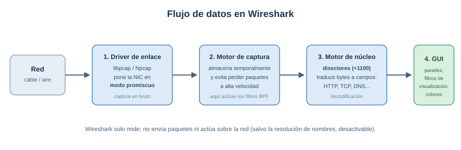

[← Volver a la página principal del repositorio](../README.md)

# Wireshark — Análisis de tráfico de red

> Resumen de la cápsula formativa «Wireshark: descubre lo que pasa dentro de la red», impartida en el **Cibernàrium de Barcelona** (Barcelona Activa). Complementa los manuales de [Networking Basics](../cursos/ccst-networking/networking-basics.md) y [Networking Devices and Initial Configuration](../cursos/ccst-networking/networking-devices-and-initial-configuration.md): aquí se ve en la práctica el tráfico (handshake TCP, DNS, ARP, puertos) que esos cursos explican en teoría.

---

## Índice

- [Qué es Wireshark (y qué no es)](#qué-es-wireshark-y-qué-no-es)
- [Cómo funciona por dentro](#cómo-funciona-por-dentro)
- [Dónde capturar: la infraestructura importa](#dónde-capturar-la-infraestructura-importa)
- [Instalación y primeros pasos](#instalación-y-primeros-pasos)
- [La interfaz: tres paneles](#la-interfaz-tres-paneles)
- [Perfiles y personalización](#perfiles-y-personalización)
- [Filtros de captura (sintaxis BPF)](#filtros-de-captura-sintaxis-bpf)
- [Filtros de visualización](#filtros-de-visualización)
- [Seguir conversaciones (streams)](#seguir-conversaciones-streams)
- [Analizar: latencia, estadísticas y GeoIP](#analizar-latencia-estadísticas-y-geoip)
- [Ensamblar y extraer datos](#ensamblar-y-extraer-datos)
- [Casos de ciberseguridad: DDoS y malware](#casos-de-ciberseguridad-ddos-y-malware)
- [Chuleta de filtros imprescindibles](#chuleta-de-filtros-imprescindibles)
- [Para seguir practicando](#para-seguir-practicando)
- [Palabras clave](#palabras-clave)

---

## Qué es Wireshark (y qué no es)

**Wireshark** es un analizador de paquetes de red, libre y de código abierto. Captura el tráfico que pasa por una interfaz, lo decodifica y lo presenta para analizarlo e interpretarlo. Reconoce más de **1.100 protocolos**. Nació como *Ethereal* y se renombró en 2006.

Lo usan administradores de red (rendimiento, pérdidas de conexión), ingenieros de seguridad (amenazas), desarrolladores (depurar protocolos), hackers éticos y estudiantes: es la mejor herramienta para ver cómo funcionan los protocolos por dentro.

Sus cuatro verbos: **capturar, presentar, analizar e interpretar** (ancho de banda, errores, latencia, malware...).

Igual de importante es lo que **no** es:

- **No es un IDS:** no genera alertas cuando pasa algo raro; ayuda a averiguar qué está pasando, pero la detección es tuya.
- **No manipula la red:** solo mide. No envía paquetes ni actúa sobre el tráfico (única excepción: la resolución de nombres, que puede desactivarse).

Cuatro grupos de tareas donde encaja: **optimización** de rendimiento, **solución de fallos** de conectividad, **seguridad** (actividad sospechosa, accesos no autorizados) y **evaluación** (auditorías, pruebas de carga).

[⬆ Volver al índice](#índice)

---

## Cómo funciona por dentro

El flujo de datos es una cadena de montaje de cuatro piezas:

1. **Driver de capa de enlace** (libpcap en Linux/macOS, Npcap en Windows): habla directamente con la tarjeta de red y la pone en **modo promiscuo** para escuchar todo el tráfico, no solo el dirigido a tu equipo.
2. **Motor de captura:** recoge los datos del driver y los almacena sin perder paquetes aunque la red vaya a alta velocidad.
3. **Motor de núcleo:** la inteligencia. Usa **disectores** para identificar cada protocolo y traducir los bytes en campos legibles (IPs, puertos, códigos de error).
4. **Interfaz gráfica:** lista de paquetes, detalle, contenido hexadecimal y los filtros de visualización para quitar ruido.

Cuando un servicio usa un puerto no estándar y el disector habitual no lo detecta, Wireshark prueba un método heurístico; si falla, el analista puede asociar el protocolo a mano (*Decode As*).

[⬆ Volver al índice](#índice)

---

## Dónde capturar: la infraestructura importa

Instalar Wireshark no basta: hay que conseguir que el tráfico que interesa llegue a tu tarjeta.

- **Limitación del switch:** conectado a un switch normal solo ves tu propio tráfico y los broadcasts, porque el switch entrega cada trama únicamente por el puerto del destinatario (la tabla MAC del manual de Networking Basics, aplicada en tu contra).
- Opciones para ver más:

| Opción | Cómo funciona | Observaciones |
|---|---|---|
| **Hub** | Repite todo por todos los puertos | Obsoleto, pero útil justo por eso |
| **Port mirroring (SPAN)** | El switch gestionable copia el tráfico de un puerto hacia el tuyo | La opción habitual en empresa |
| **Network TAP** | Dispositivo dedicado que duplica el tráfico del enlace | Fiable, pero caro |
| **Equipo puente (2 NICs)** | Un PC con dos tarjetas en medio del enlace, como "man in the middle" | Para cuando no hay acceso al switch; puede perder paquetes |

- Alternativa de laboratorio: **máquinas virtuales con redes aisladas** (VirtualBox), donde controlas todo el tráfico. Es también el entorno recomendado si se analiza malware o se quiere limitar el ruido de red.

[⬆ Volver al índice](#índice)

---

## Instalación y primeros pasos

- **Requisitos mínimos:** CPU 64 bits, 500 MB de RAM, 500 MB de disco. Windows 10/11 y Server, macOS 11+, Linux/UNIX.
- **Descarga:** [wireshark.org/download.html](https://www.wireshark.org/download.html)
- **Windows:** el instalador incluye Npcap. **macOS:** imagen .dmg; para capturar hay que instalar además el paquete *ChmodBPF* incluido. **Linux:** `apt install wireshark` (Debian/Ubuntu) o `dnf install wireshark` (Fedora); capturar requiere root o permisos especiales para el usuario.
- Consejos de la cápsula:
  - Usar el programa **en inglés**: toda la documentación lo está.
  - Pueden convivir varias versiones instaladas en carpetas distintas (ojo: las últimas versiones cambian la representación de algunos filtros).
  - Para capturar: elegir la tarjeta de red y pulsar iniciar/detener. Los ficheros se guardan en formato **pcapng** (el estándar .cap/.pcap es compatible con otros analizadores).
- Recursos oficiales: la [wiki de Wireshark](https://wiki.wireshark.org/) (protocolos, capturas de ejemplo) y el foro [Ask Wireshark](https://ask.wireshark.org/).

[⬆ Volver al índice](#índice)

---

## La interfaz: tres paneles

| Panel | Qué muestra |
|---|---|
| **Lista de paquetes** | Una fila por paquete: número, tiempo, origen, destino, protocolo, longitud e información |
| **Detalles del paquete** | Las cabeceras decodificadas por capas (Ethernet, IP, TCP, aplicación), expandibles |
| **Bytes en bruto** | El contenido en hexadecimal + ASCII; en protocolos sin cifrar, el texto se lee directamente |

Trucos de productividad vistos en clase:

- **Aplicar como columna:** clic derecho sobre cualquier campo del panel de detalles → *Apply as Column*. Útil para ver por ejemplo el puerto o el tiempo delta sin abrir cada paquete.
- Visualizar el **socket** (IP + puerto) como columnas.
- Las columnas se pueden ocultar, quitar y reordenar; la lista se puede **exportar a CSV**.
- Clic derecho sobre un campo → *Apply as Filter* o *Prepare Filter* para construir filtros sin escribir sintaxis.

[⬆ Volver al índice](#índice)

---

## Perfiles y personalización

Un **perfil** agrupa toda la configuración de la interfaz (columnas, colores, filtros guardados, disposición) y se cambia con un clic desde la esquina inferior derecha. Buena práctica: un perfil por tipo de análisis (web, DNS, VoIP, troubleshooting).

| Elemento | Para qué sirve |
|---|---|
| **Perfiles** | Cambiar de contexto de trabajo al instante |
| **Reglas de color** | Detectar errores y anomalías de un vistazo (se evalúan en orden) |
| **Columnas a medida** | Ver los datos críticos sin abrir el paquete |
| **Botones de filtro** | Accesos directos a los filtros que más repites |
| **GeoIP y resolución de nombres** | Contexto inmediato de origen y destino |

En *Edit > Preferences* (Ctrl+Mayús+P) están los ajustes de columnas, fuentes, disposición, captura y protocolos. Dos de TCP que importan:

- **Allow subdissector to reassemble TCP streams:** activado permite extraer ficheros de las capturas; desactivado muestra mejor los comandos del protocolo de aplicación.
- **Calculate conversation timestamps:** muestra el tiempo entre paquetes de cada conversación TCP (la base del análisis de latencia).

En *Name Resolution* se activan las traducciones: MAC → fabricante, puerto → servicio, IP → dominio, SNI para identificar servidores en HTTPS y la geolocalización de IPs. Hay perfiles ya hechos para importar, por ejemplo en [github.com/amwalding/wireshark_profiles](https://github.com/amwalding/wireshark_profiles).

[⬆ Volver al índice](#índice)

---

## Filtros de captura (sintaxis BPF)

Se aplican **antes** de capturar: lo que no coincide, no se guarda. Sirven para capturas largas o redes con mucho tráfico. Sintaxis BPF, distinta de la de visualización.

| Filtro | Qué captura |
|---|---|
| `host 192.168.0.1` | Tráfico desde/hacia esa IP |
| `src host 192.168.0.1` / `dst host 192.168.0.1` | Solo origen / solo destino |
| `not host 192.168.0.1` | Todo excepto esa IP |
| `net 192.168.0.0/24` | Toda la subred (CIDR) |
| `ether host 00:08:15:00:08:15` | Por dirección MAC |
| `port 53` | Puerto 53 (DNS), TCP o UDP |
| `tcp dst port 21` | TCP con destino al puerto 21 (FTP) |
| `portrange 1-80` | Rango de puertos |
| `host 192.168.0.1 and port 80` | Combinación con `and` / `or` / `not` |
| `udp src port 68 and udp dst port 67` | DHCP de cliente a servidor |
| `ip broadcast` / `ip multicast` | Broadcasts / multicast IPv4 |
| `tcp[tcpflags] == tcp-syn` | Solo paquetes con flag SYN |
| `not arp` | Todo menos ARP |

- **Opciones de captura avanzadas:** se puede crear un **anillo de ficheros** (p. ej. 3 ficheros de N paquetes que rotan) y condiciones de parada automática. Útil para capturas desatendidas.

[⬆ Volver al índice](#índice)

---

## Filtros de visualización

Se aplican **después** de capturar: ocultan sin borrar. Sintaxis propia de Wireshark, con autocompletado en la barra de filtros (verde = sintaxis válida).

**Operadores:** `==` (eq), `!=` (ne), `>` (gt), `<` (lt), `>=` (ge), `<=` (le); combinación con `&&` (and), `||` (or), `!` (not); búsqueda de texto con `contains` (literal) y `matches` (sin distinguir mayúsculas, acepta expresiones regulares).

| Categoría | Filtro | Qué muestra |
|---|---|---|
| Protocolo | `http`, `dns`, `tcp`, `udp`, `icmp`, `arp`, `ssh` | Todo el tráfico de ese protocolo |
| IP | `ip.addr == 192.168.1.50` | Esa IP como origen o destino |
| IP | `ip.src == 10.0.0.1` / `ip.dst == 10.0.0.1` | Solo origen / solo destino |
| IP | `!(ip.addr == 192.168.1.1)` | Excluir una IP |
| Subred | `ip.addr == 192.168.0.0/24` | Toda la subred |
| MAC | `eth.addr == ...` / `eth.src` / `eth.dst` | Por dirección física |
| Puerto | `tcp.port == 443` / `udp.port == 53` | HTTPS / DNS |
| Contenido | `frame contains "login"` | Paquetes con ese texto en cualquier parte |
| Contenido | `http.request.method == "GET"` | Solo peticiones GET |
| Análisis | `tcp.analysis.retransmission` | Retransmisiones: problemas de red |
| Análisis | `tcp.flags.syn == 1` | Paquetes con SYN activo |
| Tiempo | `frame.time_delta > 1` | Más de 1 s desde el paquete anterior |
| Otros | `ip.ttl <= 10`, `tcp.window_size < 1460`, `dns.count.answers >= 10` | Campos de cualquier cabecera |

Matiz importante visto en clase: **`tcp.port == 80` no es lo mismo que `http`**. El primero enseña todo lo que pasa por el puerto 80 (handshake, ACKs, keep-alives incluidos); el segundo solo los mensajes HTTP ya reensamblados, sin el ruido de control TCP.

[⬆ Volver al índice](#índice)

---

## Seguir conversaciones (streams)

Una captura mezcla decenas de conversaciones simultáneas (web, música, correo). La capa de transporte las separa en **streams**, y Wireshark permite aislarlos sin escribir filtros:

- Clic derecho sobre un paquete → **Conversation Filter** o **Follow > TCP Stream** (o UDP).
- *Follow TCP Stream* reconstruye la conversación completa como texto: en **rojo** lo que envía el cliente, en **azul** lo que responde el servidor.
- En protocolos sin cifrar (Telnet, HTTP, FTP) se lee todo: comandos, credenciales, contenido. La demostración definitiva de por qué existen SSH y HTTPS.
- La ventana **Statistics > Conversations** lista todas las conversaciones de la captura con sus volúmenes de datos.

[⬆ Volver al índice](#índice)

---

## Analizar: latencia, estadísticas y GeoIP

### Latencia

La latencia es el tiempo que tarda una operación en completarse. Tres orígenes posibles, y Wireshark ayuda a señalar al culpable:

| Origen | Pista |
|---|---|
| **Recorrido (red)** | Retrasos entre petición y respuesta en el segmento de red |
| **Cliente** | Retrasos del lado del PC; a menudo falsos positivos (interacción del usuario) |
| **Servidor** | El servidor tarda en responder: falta de recursos o dependencias (almacenamiento) |

Herramienta clave: el **tiempo delta** (tiempo desde el paquete anterior, columna `frame.time_delta` o el delta por conversación TCP). Deltas grandes señalan dónde se pierde el tiempo. Un ejemplo de clase: filtrar los SYN retransmitidos tras más de 1 segundo delata intentos de conexión que no obtienen respuesta.

### Estadísticas

| Menú | Qué da |
|---|---|
| **Statistics > Endpoints** | Qué nodos mueven más paquetes/bytes (ordenable por columnas) |
| **Statistics > Conversations** | Las conversaciones y su volumen |
| **Statistics > Protocol Hierarchy** | Distribución del tráfico por protocolo |
| **Statistics > I/O Graphs** | Gráfica de tráfico contra tiempo (paquetes/s o bits/s), con filtros por serie |

### GeoIP

Con las bases de datos gratuitas **GeoLite2** de MaxMind (ASN, City, Country), Wireshark geolocaliza las IPs públicas: *Edit > Preferences > Name Resolution > MaxMind Database Directories*, señalar la carpeta con los tres ficheros y reiniciar. Después, *Statistics > Endpoints* muestra país y ciudad de cada nodo. Útil en seguridad para detectar conexiones desde ubicaciones inesperadas.

### Tráfico de fondo

Antes de buscar anomalías conviene conocer el **ruido normal** del equipo: actualizaciones del antivirus y del sistema, Spotify, Teams... Todo eso aparece en la captura sin que hagas nada. El tráfico típico de una navegación es la secuencia: consulta **DNS** → **handshake TCP** → transferencia **HTTP/HTTPS**.

[⬆ Volver al índice](#índice)

---

## Ensamblar y extraer datos

Reensamblar los streams permite recuperar lo que viajó por la red: ficheros, páginas, llamadas.

### HTTP

- **Métodos de petición:** seguros (GET, HEAD, OPTIONS, TRACE) y no seguros (POST, PUT, DELETE, PATCH).
- **Códigos de respuesta:** 1XX informativos, 2XX éxito (200 OK), 3XX redirección, 4XX error del cliente (404 Not Found), 5XX error del servidor.
- **Extraer ficheros:** activar *Allow subdissector to reassemble TCP streams* y usar **File > Export Objects > HTTP**: lista los objetos descargados (imágenes, documentos) y los guarda con *Save as*.

### FTP

Protocolo con dos conexiones: control (puerto 21) y datos (puerto 20). Para extraer un fichero: seguir el stream de control para ver el nombre del fichero transferido, localizar los paquetes FTP-DATA, seguir ese stream, mostrar en formato *raw* y guardar con el nombre original.

### Telnet y DNS

- **Telnet** no cifra: con *Follow TCP Stream* se lee la sesión completa, credenciales incluidas.
- **DNS** va sobre UDP y el *Follow UDP Stream* aporta poco; la información útil está en las cabeceras DNS (consultas, respuestas, contadores).

### VoIP

Wireshark puede reconstruir llamadas telefónicas (SIP/RTP) y reproducir el audio capturado.

[⬆ Volver al índice](#índice)

---

## Casos de ciberseguridad: DDoS y malware

### Detectar un ataque DDoS

Método de análisis practicado en el lab:

1. **Statistics > Endpoints:** ordenar por paquetes/bytes y localizar la IP que recibe un volumen anormal: probable objetivo.
2. **Statistics > Protocol Hierarchy:** ver qué protocolo domina el tráfico (una mayoría aplastante de TCP o ICMP es sospechosa).
3. **Filtrar los SYN sin respuesta:** `tcp.flags.syn == 1 and tcp.flags.ack == 0`. Muchos SYN hacia la misma IP de destino desde orígenes distintos, sin completar el handshake = **SYN flood**.
4. **Analizar los puertos:** `tcp.port == 80` para confirmar el servicio atacado.
5. Otras variantes: inundación de ACK/RST, de conexiones TCP completas, o **ICMP flood** (avalancha de pings desde muchas IPs hacia un objetivo).

Pistas adicionales del reto: campos **TTL** e **identificación IP** con patrones repetitivos o incoherentes delatan tráfico generado artificialmente.

### Analizar malware en una captura

Siempre en **máquina virtual** (y recordando reactivar el antivirus al acabar). Flujo del lab final:

1. `http.request` para ver qué peticiones web hizo la víctima y qué host entregó el exploit.
2. **DHCP o NBNS** para identificar el nombre del equipo infectado; la MAC sale de la cabecera Ethernet.
3. **File > Export Objects > HTTP** para extraer los ficheros descargados.
4. Calcular el **hash** de cada fichero (p. ej. con HashMyFiles) y consultarlo en VirusTotal.

Por qué se sube el **hash y no el fichero**: el fichero puede contener datos confidenciales de la organización; el hash funciona como huella digital, permite consultar si ya está identificado como malicioso, y sirve para configurar bloqueos automáticos en las herramientas de seguridad. Si el hash no devuelve resultados, podría tratarse de un posible zero-day.

[⬆ Volver al índice](#índice)

---

## Chuleta de filtros imprescindibles

| Necesito ver... | Filtro |
|---|---|
| Solo el tráfico de una IP | `ip.addr == x.x.x.x` |
| Solo web / DNS / ping | `http` · `dns` · `icmp` |
| HTTPS | `tcp.port == 443` |
| Lo que contiene una palabra | `frame contains "palabra"` |
| Problemas de red (reenvíos) | `tcp.analysis.retransmission` |
| Inicios de conexión | `tcp.flags.syn == 1` |
| Posible SYN flood | `tcp.flags.syn == 1 and tcp.flags.ack == 0` |
| Silencios largos | `frame.time_delta > 1` |
| Peticiones web realizadas | `http.request` |
| Todo menos ARP | `!arp` |

[⬆ Volver al índice](#índice)

---

## Para seguir practicando

- [TryHackMe — sala h4cked](https://tryhackme.com/room/h4cked)
- [Malware Traffic Analysis — ejercicios con PCAPs reales](https://www.malware-traffic-analysis.net/training-exercises.html)
- [Capturas de ejemplo de la wiki de Wireshark](https://wiki.wireshark.org/samplecaptures)

[⬆ Volver al índice](#índice)

---

## Palabras clave

*packet analyzer · sniffer · promiscuous mode · libpcap/Npcap · dissector · pcap/pcapng · capture filter (BPF) · display filter · port mirroring (SPAN) · network TAP · follow TCP stream · conversation/endpoints · protocol hierarchy · I/O graph · time delta · latency · retransmission · SYN flood · ICMP flood · GeoIP (MaxMind GeoLite2) · export objects · file hash · VirusTotal · profiles · coloring rules · name resolution · decode as*

[⬆ Volver al índice](#índice)

---

*Resumen de la cápsula bootcamp de Wireshark cursada desde Barcelona Activa. Material libre para compartir con la clase.*
